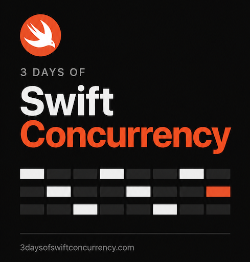

# Amigos

<p align="center">
  
</p>

**Practise Spanish. Make Amigos. Keep their stories alive.**

Amigos is a native iOS conversation app where a lively group of fictional
ghostly friends sends messages from the other side. Reply in Spanish, get an
on-device AI response with its English counterpart already saved beside it,
and build a relationship through ordinary chats and practical role plays.

The premise is playful, but the purpose is serious: language becomes easier
when there is somebody worth replying to. Every Amigo has a distinct voice,
personality and remembered story. They live in the app through conversation;
the more you speak with them, the more their character comes alive.

<p align="center">
  <a href="https://www.3daysofswiftconcurrency.com/">
    
  </a>
</p>

<p align="center">
  <a href="https://www.3daysofswiftconcurrency.com/"><strong>Visit 3DaysOfSwiftConcurrency.com →</strong></a>
</p>

## What Amigos does

- Chat in natural Spanish with a growing cast of Amigos, each with a profile,
  biography and a different topic or energy.
- Tap a reply to reveal the English translation already returned with the
  original AI response—no second request is made.
- Try repeatable Role Plays such as ordering at a café. Each session begins
  fresh, making it useful for real-world practice.
- Earn doubloons through sustained friend conversations; spend them through a
  satisfying slide-to-unlock admission to Role Play.
- Track a daily Spanish streak, total typed words, unique words and the days
  since you joined.
- Choose from seven app-wide colour themes and chat wallpapers made from the
  Amigos visual language: skulls, guitars, flowers, books, glasses, palms,
  sombreros and more.

Everything is local to the device: no account, cloud service, analytics SDK or
API key is required.

## The Amigos world

The Amigos are fictional friends from the afterlife. Their world is about
memory, not loss: people remain vivid when we talk about them, tell their
stories, and make room for their quirks. The user is alive—their own portrait
is deliberately distinct from the skull-faced Amigos—and receives messages
from friends who are still curious, funny, awkward and keen to connect.

This gives the product a useful emotional rule: Amigos should feel like mates,
not tutors. They reply naturally in Spanish, make gentle ghostly jokes when it
fits, and invite the learner into an ongoing friendship.

## Built by 3 Days of Swift Concurrency

[3 Days of Swift Concurrency](https://www.3daysofswiftconcurrency.com/) creates
practical iOS developer training and production-quality reference apps. Amigos
is part of the same family as Cuentiva: a focused Spanish-learning experience
with its own personality, product loop and visual identity.

The project demonstrates SwiftUI, Observation, Apple Intelligence on-device
generation, and maintainable feature ownership through Cooperative Feature
Architecture.

## Cooperative Feature Architecture

Amigos uses **Cooperative Feature Architecture (CFA)**: explicit feature
boundaries, screen-owned ViewModels and replaceable repositories. The approach
makes the route from an interaction to durable data easy to follow for people
and coding agents alike.

```text
View → ViewModel → Feature API → Feature Manager → Repository
```

For a chat, that becomes:

```text
ChatView → ChatViewModel → ConversationFeature → ConversationManager
                                                       ├── OnDeviceSpanishChat
                                                       └── LocalConversationRepository
```

Explore the [CFA toolkit and skills](https://github.com/3DaysOfSwift/cooperative-feature-architecture).

### Feature ownership

| Area | Owner |
| --- | --- |
| Chat history, Role Play admission, rewards, wallet and streaks | `ConversationManager` |
| On-device bilingual responses and response validation | `OnDeviceSpanishChat` |
| Local chat archive and one-time HolaTalk migration | `LocalConversationRepository` |
| Learner display name and profile persistence | `ProfileManager` / `LocalProfileRepository` |
| Colour theme and wallpaper selection | `ThemeManager` |
| Production dependency graph | `AppModel.shared` |

Each screen owns one adjacent `@MainActor @Observable` ViewModel. The app uses
one production composition root, while tests construct isolated feature graphs.

## Run Amigos

1. Open [`Amigos.xcodeproj`](Amigos.xcodeproj) in Xcode 26 or later.
2. Select the **Amigos** scheme and an iOS 26 simulator or device.
3. Run the app. The chat list is the launch screen; choose an Amigo or open a
   Role Play from the dedicated tab.
4. For live AI replies, run on a supported physical device with Apple
   Intelligence enabled and the system language model available.

The app has no third-party package dependencies. Its bundle identifier is
`com.3DaysOfSwiftConcurrency.Amigos` and the deployment target is iOS 26.

The simulator can exercise the interface and deterministic test graph, but it
cannot provide a real on-device language-model conversation.

## Product rules

- A friend chat is free. The first 10 successful exchanges with an individual
  Amigo in one day earn one doubloon; every 40 additional successful exchanges
  with that Amigo earn another.
- Role Plays cost two doubloons and require the slide-to-unlock admission.
  The charge happens only after the first successful reply, and the active
  session remains available for ten minutes.
- Role Plays never earn chat rewards.
- The English version of an AI reply is saved together with its Spanish text.
  Revealing it in the UI is instantaneous and does not call the model again.
- Conversation data, progress, profile and visual preferences are stored on
  the device. Existing HolaTalk local data is copied forward once into Amigos
  storage.

The maintained requirements and outstanding device checks are recorded in
[`MIGRATION_BEHAVIOUR_CONTRACT.md`](MIGRATION_BEHAVIOUR_CONTRACT.md).

## Privacy and accessibility

Amigos does not use accounts, analytics, advertising SDKs or a backend. Chats,
rewards, profile details and themes remain on the device and may be included in
normal device backups. The on-device model is used only when available; the app
reports clearly when Apple Intelligence is unavailable and does not spend a
doubloon for a failed response.

The interface supports Dynamic Type, VoiceOver labels, Reduce Motion, colour
themes with light and dark appearances, and visible non-colour state feedback.
Hands-on device validation remains important for Apple Intelligence availability
and the final visual experience at extreme text sizes.

## Tests

The test suite is organised by CFA boundary:

- `AmigosTests/ViewModelTests` — one focused suite per screen ViewModel.
- `AmigosTests/FeatureTests` — conversation, reward, admission and profile
  business rules.
- `AmigosTests/PersistenceTests` — local archive and legacy migration behaviour.
- `AmigosTests/ThemeTests` — theme persistence and the HolaTalk-to-Amigos
  preference migration.

Run the **Amigos** scheme tests before changing chat, wallet or persistence
rules. On-device AI output and visual animation still require manual validation
on a supported physical device.
